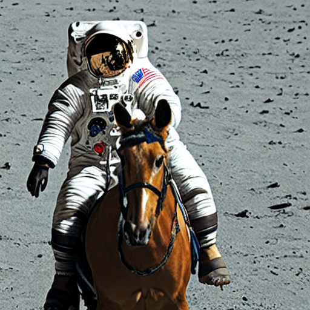

# imagehub

An inference library for open-weight image generation architectures, natively reimplemented in
PyTorch behind a single API. **PyTorch is the only required runtime dependency.** A model is added
only once it is shown to reproduce the original implementation's output
([validation](docs/validation.md)). On CPU in float32, outputs are bit-identical to their recorded
reference implementations; the details are on the [validation](docs/validation.md) page.
Architectures are linked to the
[awesome-text-to-image-architectures](https://github.com/gorkemgul/awesome-text-to-image-architectures)
catalog.



## Installation

```bash
pip install imagehub            # torch only
pip install "imagehub[image]"   # adds Pillow for Image.to_pil()
```

## Usage

```bash
python -m imagehub.pretrained sd-v1-5 checkpoints/sd-v1-5
```

```python
from imagehub import pipeline

with pipeline("t2i", backend="sd-v1-5", model="checkpoints/sd-v1-5") as pipe:
    result = pipe("a photograph of an astronaut riding a horse", seed=42)
result.images[0].save("astronaut.png")
print(result.metadata)
```

Downloads happen only through `imagehub.pretrained`, and only when you run it.

- The validated commit is pinned.
- Every file is checked against its size. Weight files are also checked against the sha256 the
  Hub publishes, and all other files against their git blob sha1 (`blobId`).
- An `imagehub_snapshot.json` manifest records what was downloaded.

`pipeline()` never accesses the network.

Most models take a text prompt only. `flux1-kontext-dev` also takes an optional input image
(`image`) and edits it by instruction; without one it generates from the text alone.
`sdxl-refiner-1.0` requires an input image (`image`, with `strength`) and refines it.

```python
from PIL import Image
from imagehub import pipeline

with pipeline(
    "t2i", backend="flux1-kontext-dev", model="checkpoints/flux1-kontext-dev"
) as edit:
    result = edit("Add a red hat to the scene", image=Image.open("photo.png"), seed=0)
result.images[0].save("edited.png")
```

## Models

| Family | Checkpoints | Task | Input | Validation |
| --- | --- | --- | --- | --- |
| Stable Diffusion | `sd-v1-1`, `sd-v1-2`, `sd-v1-3`, `sd-v1-4`, `sd-v1-5`, `sd-v2-1`, `sd-turbo`, `lcm-dreamshaper-v7` | `t2i` | T | CPU fp32 parity |
| Stable Diffusion XL | `sdxl-base-1.0`, `sdxl-lightning-2step`, `sdxl-lightning-4step`, `sdxl-lightning-8step`, `hyper-sdxl-1step`, `dmd2-sdxl-4step`, `dmd2-sdxl-1step`, `sdxl-turbo`, `ssd-1b`, `playground-v2`, `playground-v2.5` | `t2i` | T | CPU fp32 parity |
| Stable Diffusion XL refiner | `sdxl-refiner-1.0` | `t2i` | T, I | CPU fp32 parity |
| Stable Diffusion 3 and 3.5 | `sd3-medium`, `sd3.5-medium`, `sd3.5-large`, `sd3.5-large-turbo` | `t2i` | T | CPU fp32 parity |
| FLUX.1 | `flux1-schnell`, `flux1-dev`, `flux1-krea-dev` | `t2i` | T | CPU fp32 parity |
| FLUX.1 Kontext | `flux1-kontext-dev` | `t2i` | T, I | CPU fp32 parity |
| FLUX.2 | `flux2-klein-4b`, `flux2-klein-9b` | `t2i` | T | CPU fp32 parity |
| HunyuanDiT | `hunyuan-dit-v1.1-distilled`, `hunyuan-dit-v1.2`, `hunyuan-dit-v1.2-distilled` | `t2i` | T | CPU fp32 parity |
| Kandinsky 2.2 | `kandinsky-2.2` | `t2i` | T | CPU fp32 parity |
| Stable Cascade | `stable-cascade`, `stable-cascade-lite` | `t2i` | T | CPU fp32 parity |
| Würstchen v2 | `wuerstchen-v2` | `t2i` | T | CPU fp32 parity |
| PixArt | `pixart-sigma-xl-1024`, `pixart-sigma-xl-512`, `pixart-sigma-xl-256`, `pixart-sigma-xl-2k`, `pixart-alpha-xl-1024`, `pixart-alpha-xl-512` | `t2i` | T | CPU fp32 parity |
| Sana | `sana-1600m-1024`, `sana-600m-1024` | `t2i` | T | CPU fp32 parity |
| Kolors | `kolors` | `t2i` | T | CPU fp32 parity on the upcast float16 weights |
| Lumina-Image 2.0 | `lumina-image-2.0` | `t2i` | T | CPU fp32 parity |
| aMUSEd | `amused-256`, `amused-512` | `t2i` | T | CPU fp32 parity |
| AuraFlow | `auraflow-v0.3` | `t2i` | T | CPU fp32 parity |
| LlamaGen | `llamagen-t2i-xl-256`, `llamagen-t2i-xl-512` | `t2i` | T | CPU fp32 parity |
| Krea 2 | `krea2-turbo` | `t2i` | T | CPU fp32 parity |
| ERNIE-Image | `ernie-image` | `t2i` | T | CPU fp32 parity without the prompt enhancer |
| LongCat-Image | `longcat-image` | `t2i` | T | CPU fp32 parity |
| CogView3-Plus | `cogview3-plus-3b` | `t2i` | T | CPU fp32 parity on the upcast bfloat16 transformer and VAE |
| CogView4 | `cogview4-6b` | `t2i` | T | CPU fp32 parity |
| Ideogram 4 | `ideogram4-fp8` | `t2i` | T | CPU fp32 parity with the official implementation |
| Qwen-Image | `qwen-image-2.1` | `t2i` | T | CPU fp32 parity |
| Z-Image | `z-image`, `z-image-turbo` | `t2i` | T | CPU fp32 parity |
| Janus-Pro | `janus-pro-1b`, `janus-pro-7b` | `t2i` | T | CPU fp32 parity |

[Catalog](docs/catalog.md) · [Model pages](docs/models.md) · [Validation](docs/validation.md) ·
[Third-party notices](THIRD_PARTY_NOTICES.md)

## Development

```bash
uv venv -p 3.13 .venv && uv pip install --python .venv -e ".[dev,image]"
.venv/bin/python -m pytest
```

Reference comparisons are optional and never download anything:

```bash
uv pip install --python .venv -e ".[dev,image,reference]"
IMAGEHUB_REFERENCE_TESTS=1 IMAGEHUB_SD_V1_5=checkpoints/sd-v1-5 .venv/bin/python -m pytest tests/reference
IMAGEHUB_REFERENCE_TESTS=1 IMAGEHUB_SNAPSHOT_SDXL_TURBO=checkpoints/sdxl-turbo .venv/bin/python -m pytest tests/reference/test_ref_sdxl.py
```

## License

The code is licensed under Apache-2.0. Model weights are subject to their own licenses and are not
distributed with imagehub.
